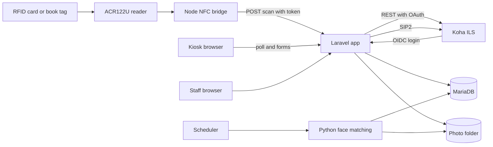
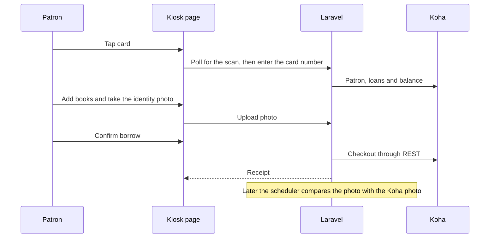

# KUET SmartLib

**An RFID and Face-Verification Based Self-Service Library System**

KUET SmartLib lets library patrons borrow, return and renew books at a self-service kiosk by tapping an RFID card. Borrowing needs an identity photo taken at the kiosk. The photo is compared automatically with the patron's registered photo in the Koha library system, and librarians review any doubtful result on a staff dashboard. Koha stays the system of record for patrons, items and loans. This Laravel application adds the kiosk, the verification pipeline, the staff tools and the reports.

## Contents

1. [Features](#features)
2. [How it works](#how-it-works)
3. [Technology](#technology)
4. [Requirements](#requirements)
5. [Installation](#installation)
6. [Configuration reference](#configuration-reference)
7. [Face matching service](#face-matching-service)
8. [NFC reader bridge](#nfc-reader-bridge)
9. [Single sign-on with Koha](#single-sign-on-with-koha)
10. [Running the system](#running-the-system)
11. [Using the system](#using-the-system)
12. [Artisan commands](#artisan-commands)
13. [Roles and permissions](#roles-and-permissions)
14. [Data model](#data-model)
15. [Security and privacy](#security-and-privacy)
16. [Testing](#testing)
17. [Troubleshooting](#troubleshooting)
18. [Project structure](#project-structure)
19. [Known limitations and roadmap](#known-limitations-and-roadmap)
20. [Acknowledgements](#acknowledgements)

## Features

**Kiosk (patron side)**

- Log in by tapping an RFID card. A typed card number is available for development and can be switched off for deployment.
- Borrow and return with a cart: tap the book tag or type the barcode, review the list, confirm.
- Renew loans from the kiosk dashboard.
- Identity photo before every borrow, with live face detection in the browser, a mask hint, and a fallback button so a patron is never stuck.
- 58 mm receipt as PDF, shown on screen and printable.
- Borrowing limits by patron category, fines shown in the local currency, automatic logout after inactivity.
- Returns go through the SIP2 protocol, checkouts and renewals through the Koha REST API.

**Verification (automatic)**

- The patron's Koha photo is cached locally and compared with each kiosk photo by an OpenCV face matcher (YuNet detector and SFace recogniser).
- Each photo gets a result: matched, mismatch, no face, no Koha photo, or Koha photo unusable. A mismatch means "needs review", never an accusation.
- A scheduled job matches new photos every minute and deletes old photos after a retention period that administrators can change.

**Staff side**

- Staff log in with their Koha card number and a Laravel password. Roles and permissions are managed in Laravel.
- Verification History: one card per patron, a symbol per photo, filters by card, action, date and status, and a photo page with the Koha photo and the kiosk photo side by side.
- Review actions with a note: Mark as OK, Flag as a problem, Re-open.
- Top menu counter and dashboard panel "Verification warnings".
- Weekly report as a printable A4 page or a CSV file, with a choice of what to include.
- Circulation dashboard with a chart, activity log, a small task delegation module for library staff, and an Admin-only settings page for photo retention.
- Single sign-on: Koha's own staff login can use this application as its OpenID Connect login server, so staff use one set of credentials.

## How it works



A borrow, step by step:



1. The NFC bridge reads the tag and posts its UID to `/api/kiosk/scan` with a secret token.
2. Laravel looks the UID up in `rfid_cards` (patron) or `book_tags` (book) and keeps the result for a few seconds.
3. The kiosk page polls `/api/kiosk/poll` (allowed from the kiosk computer only) and submits the card number to `/kiosk/enter`.
4. Laravel asks Koha for the patron, current loans and balance and starts the kiosk session.
5. For a borrow, the patron takes an identity photo. It is saved on the configured photo disk and recorded in `patron_verification_captures`.
6. The scheduler runs `verification:match`, which fetches or reuses the cached Koha photo, runs the Python matcher and saves the result.
7. Staff see warnings in the menu and dashboard and review them in Verification History.

## Technology

| Part | Technology |
|---|---|
| Application | Laravel 12 (PHP 8.2 or newer), Blade, Tailwind CSS 3, Alpine.js, Vite 7 |
| Library system | Koha ILS (developed against the koha-testing Docker image) |
| Database | MariaDB or MySQL (SQLite in memory for the automated tests) |
| Single sign-on | Laravel Passport 13 with `admin9/laravel-oidc-server` 1.1 |
| Receipts | barryvdh/laravel-dompdf |
| Face matching | Python 3 with OpenCV (YuNet face detector, SFace recogniser) |
| In-browser face check | face-api.js (served from `public/vendor`, no internet needed) |
| Dashboard chart | Chart.js (served from `public/vendor`) |
| Card reader | ACR122U NFC reader, Node.js bridge using `nfc-pcsc` |
| Networking in our setup | Tailscale between the laptops |

## Requirements

- PHP 8.2 or newer with the extensions `curl`, `exif`, `fileinfo`, `gd`, `mbstring`, `openssl` and `pdo_mysql` (and `pdo_sqlite` to run the tests)
- Composer 2
- Node.js 20.19 or newer and npm (needed by Vite 7)
- MariaDB or MySQL
- A running Koha instance with the REST API reachable, a SIP2 account and patron photos (see [Installation](#installation))
- Python 3 and OpenCV for the face matcher (see [Face matching service](#face-matching-service))
- For a real kiosk: an ACR122U reader with its PC/SC driver, and Node.js for the bridge

## Installation

### 1. Get the code and install dependencies

```bash
git clone https://github.com/AnweshaDS/RFID-based-Self-Service-Library-System.git
cd RFID-based-Self-Service-Library-System
composer install
npm install
npm run build
```

### 2. Create the environment file

```bash
cp .env.example .env        # Windows: copy .env.example .env
php artisan key:generate
```

`.env.example` holds Laravel's defaults. Add the SmartLib settings from the [configuration reference](#configuration-reference) and set the database connection.

### 3. Prepare Koha

Before the kiosk can work, Koha needs:

- A REST API client (client id and secret) that the application uses with OAuth client credentials. These go into `KOHA_CLIENT_ID` and `KOHA_CLIENT_SECRET`, and the API address into `KOHA_BASE_URL`.
- Patron categories whose codes match `config/kiosk.php` (the category decides the borrowing limit).
- A SIP2 account for the kiosk. The development setup used Koha's demo SIP account. **Replace it with a dedicated account before real use.**
- A photo uploaded for each patron, since the face matcher needs a reference photo.

### 4. Create the database and tables

```bash
php artisan migrate
php artisan db:seed
php artisan db:seed --class=RolePermissionSeeder
```

`db:seed` creates a placeholder test user, departments, the base roles and four demo RFID cards. `RolePermissionSeeder` creates the staff roles and their permissions. The demo user and cards are for development only: delete or change them before real use.

### 5. Create the first staff accounts

Staff log in with their Koha card number and a Laravel password. Create accounts with the artisan command (it looks the person up in Koha first):

```bash
php artisan staff:create CARDNUMBER --role=Admin
```

It asks for a password twice (nothing is shown) and needs at least 10 characters. See [Artisan commands](#artisan-commands).

### 6. Register cards and book tags

Cards and tags are rows in the `rfid_cards` (UID and Koha card number) and `book_tags` (UID and barcode) tables. There is no admin page for this yet. Add rows with a seeder, tinker or SQL. UIDs are stored as upper-case hexadecimal text.

### 7. Set up photo storage

Kiosk photos and cached Koha photos are saved on a Laravel disk named `verification`. By default it is `storage/app/private`. To use another folder, for example a network share that the staff website also reads, set `VERIFICATION_STORAGE_PATH`. On Windows the staff laptop reads the share through a mapped drive, so run the web server in a normal (non-administrator) window that can see that drive.

### 8. Set up face matching and the reader

See [Face matching service](#face-matching-service) and [NFC reader bridge](#nfc-reader-bridge).

## Configuration reference

Add these to `.env`. Values in brackets are the defaults.

**Koha**

| Variable | Purpose |
|---|---|
| `KOHA_BASE_URL` | Koha REST API address (a development address is the default) |
| `KOHA_CLIENT_ID`, `KOHA_CLIENT_SECRET` | OAuth client for the REST API |
| `KOHA_STAFF_URL` | Koha staff interface address (used for the combined logout) |
| `KOHA_SIP_HOST`, `KOHA_SIP_PORT` | SIP2 server (`127.0.0.1`, `6003`) |
| `KOHA_SIP_USER`, `KOHA_SIP_PASSWORD` | SIP2 account |
| `KOHA_SIP_INSTITUTION` | SIP2 institution id (`CPL`) |

**Kiosk**

| Variable | Purpose |
|---|---|
| `KIOSK_TOKEN` | Secret that the NFC bridge sends in the `X-Kiosk-Token` header. Scans are refused while it is empty |
| `KIOSK_ID`, `KIOSK_NAME` | Which kiosk this computer is (shown in the activity log) |
| `KIOSK_IDLE_TIMEOUT` | Seconds of inactivity before logout (`360`) |
| `KIOSK_CURRENCY` | Currency label for fines (`BDT`) |
| `KIOSK_ALLOW_MANUAL_ENTRY` | `true` shows the typed card number box. Set `false` before deployment so only a real card tap can log in (`true`) |
| `KIOSK_ALLOWED_IPS` | Addresses allowed to call `/api/kiosk/poll`, comma separated (`127.0.0.1,::1,::ffff:127.0.0.1`) |

**Verification**

| Variable | Purpose |
|---|---|
| `VERIFICATION_STORAGE_PATH` | Folder for photos (`storage/app/private`) |
| `KIOSK_PHOTO_DISK` | Laravel disk name for photos (`verification`) |
| `KIOSK_PHOTO_RETENTION_DAYS` | Ordinary photos are kept this many days (`90`) |
| `KIOSK_FLAGGED_RETENTION_DAYS` | Photos needing review or flagged are kept this many days (`365`) |
| `FACE_PYTHON` | Python used for matching (`face-service/.venv/Scripts/python.exe`, a Windows path) |
| `FACE_SCRIPT` | Matching script (`face-service/match.py`) |
| `FACE_MATCH_THRESHOLD` | Cosine score at or above which two faces count as the same person (`0.363`) |

Administrators can also change the retention periods on the Photo retention settings page.

**Application, database and sign-on**

| Variable | Purpose |
|---|---|
| `APP_URL`, `APP_DEBUG` | Set `APP_DEBUG=false` outside development. Error pages with debug on can show submitted passwords |
| `DB_CONNECTION`, `DB_HOST`, `DB_PORT`, `DB_DATABASE`, `DB_USERNAME`, `DB_PASSWORD` | Database connection (`mysql` or `mariadb`) |
| `DB_CONNECT_TIMEOUT` | Seconds before a database connection attempt gives up (`5`) |
| `SESSION_DRIVER`, `SESSION_LIFETIME`, `SESSION_DOMAIN` | Laravel session settings (lifetime `120` minutes) |
| `OIDC_ISSUER` | Address Koha uses to reach the login server (the app address) |
| `OIDC_ACCESS_TOKEN_TTL`, `OIDC_REFRESH_TOKEN_TTL`, `OIDC_ID_TOKEN_TTL` | Token lifetimes in seconds (`900`, `604800`, `900`) |
| `SMARTLIB_NAME`, `SMARTLIB_FULL_TITLE` | Names shown in menus and report headers |

Borrowing limits per patron category are set in `config/kiosk.php`. The project currently defines `ST` (5 books), `UG` (3 books) and `T` (15 books, code still to be confirmed against Koha). Any other category gets 3 books.

After changing `.env`, run `php artisan config:clear`.

## Face matching service

The matcher is a small Python script, `face-service/match.py`. It reads two images and prints one line of JSON:

```bash
python face-service/match.py KOHA_PHOTO KIOSK_PHOTO --threshold 0.363
# {"status": "matched", "score": 0.595, "faces": 1}
```

`status` is one of `matched`, `mismatch`, `no_face` (no face in the kiosk photo), `reference_unusable` (no face in the Koha photo) or `error`.

**Setup**

1. Create a virtual environment inside `face-service` and install the packages:

   ```bash
   cd face-service
   python -m venv .venv
   .venv/Scripts/pip install opencv-python numpy      # Linux and macOS: .venv/bin/pip
   ```

   The project was developed and tested with OpenCV 5.0.
2. Download the two ONNX models from the OpenCV Zoo project and put them in `face-service/models`. This folder is not stored in git:
   - `face_detection_yunet_2023mar.onnx`
   - `face_recognition_sface_2021dec.onnx`
3. If the Python path is not the Windows default, set `FACE_PYTHON` in `.env`.
4. Try it on two sample photos as shown above before relying on it.

**Notes**

- The default threshold `0.363` is OpenCV's suggested starting value for this model. It has not yet been calibrated on this library's own photos. Review the mismatch results on real data (glasses, masks, head coverings) before treating the score as final.
- If the script fails on a damaged photo, the scheduler skips that photo and carries on with the others. It stops only after five failures in a row, which points at the tool itself.

## NFC reader bridge

The bridge is a small Node.js program (using `nfc-pcsc`) that runs on each kiosk computer next to the ACR122U reader. It is kept outside this repository. It only needs to talk to two endpoints, both protected by the `X-Kiosk-Token` header:

| Request | Body | Meaning |
|---|---|---|
| `POST /api/kiosk/scan` | `{"uid": "53CC54AE420001"}` | A tag was tapped. Non-hex characters are removed and the UID is upper-cased |
| `POST /api/kiosk/reader-status` | `{"connected": true}` | The reader is plugged in (`false` when it is not). The welcome page shows a notice when the reader is offline |

A scan returns `{"ok": true, "type": "patron"}`, `{"ok": true, "type": "book"}`, or an error notice on the kiosk screen when the tag is not registered or inactive. Each kiosk computer needs its own token in its own `.env`.

## Single sign-on with Koha

Koha is the OpenID Connect client and this application is the login server, so staff sign in to Koha with the same credentials they use here. The provider code in Koha is `Laravel_OIDC`. The claims are `sub`, `name`, `email` and `preferred_username`, where `preferred_username` is the staff member's Koha card number, with the scope `koha`.

**Do not change these without updating Koha at the same time:**

- the issuer address (`OIDC_ISSUER`)
- the Passport signing keys in `storage`
- the OAuth client id and secret
- the provider code and the claim mapping
- the CSRF exceptions for the `oauth/*` routes in `bootstrap/app.php`
- the `koha_patron_id` and `koha_cardnumber` columns on `users`

If Koha shows "No configuration found for your provider", its running services have lost the provider after a container restart. First check that Koha can reach the login server's `/.well-known/openid-configuration` address (it must answer 200). Only then restart Koha's services inside its container.

There are two logout choices: "Log Out of KUET SmartLib" (this application only) and "Log Out of KUET SmartLib and Koha".

## Running the system

**Development**

```bash
php artisan serve --host=0.0.0.0 --port=8000
npm run dev
php artisan schedule:work
```

The root address redirects to the kiosk welcome page. Staff log in at `/login`.

**A kiosk computer**

1. Start the Laravel server on port 8000.
2. Start the NFC bridge.
3. Open the kiosk page in a full-screen browser, for example `chrome --kiosk http://localhost:8000/kiosk`. Use `localhost` so the kiosk is recognised as the kiosk computer.

**Scheduler (run it on one computer only)**

The scheduler matches new photos every minute and prunes old photos daily at 02:00. In production, call `php artisan schedule:run` every minute (cron on Linux, Task Scheduler on Windows). Because photos are matched where their files can be reached, run it on the computer that holds the photo folder.

**Startup after everything was off**

1. Start the database and Koha containers. Confirm the database port is published.
2. Confirm the photo folder is reachable from every computer that needs it.
3. Start the web server, check the OpenID configuration address shows JSON, and test the single sign-on link.
4. Plug in the reader and start the kiosk.
5. Run `php artisan verification:match --limit=50`, and after long shutdowns `php artisan verification:cache-koha-photos`.
6. Check one staff login, the history page, one borrow or return, and that a new photo gets a result within a minute.

**Shutdown:** close the kiosk and server windows and shut the computer down normally. Never run `docker compose down -v` or Koha's `reset_all`, and never delete the database volume.

## Using the system

### Patron at the kiosk

1. Tap the card on the reader.
2. Choose Borrow or Return (or Renew from the dashboard).
3. Tap each book tag, or type the barcode, to fill the cart.
4. For a borrow, look at the camera and take the identity photo. If no face is found after a few seconds, a button lets the patron take the photo anyway, and staff will review it.
5. Confirm. Take the receipt, then log out. The kiosk logs the patron out after a period of inactivity.

### Staff

- **Verification History** lists every patron with a badge showing how many photos need review. Symbols: red triangle (does not match the Koha photo), amber triangle (no face found), grey i (no Koha photo to compare with), green check (matched, or reviewed OK), red flag (flagged by staff), grey clock (not checked yet).
- Open a photo to compare the Koha photo and the kiosk photo, see the score and the books of that transaction, and add a review: Mark as OK, Flag as a problem, or Re-open, each with a note.
- **Report** (`/patron-verification/report`): pick dates (last 7 days by default, at most 31), then open the printable A4 report or download the CSV. A panel asks what to include: all transactions, verified by the system, verified by staff, or not verified (the default), with more choices for all warnings, flagged by staff, not checked yet and no Koha photo. Exports are logged.
- **Settings, Photo retention** (Admin only): how long photos are kept.

Verification pages are open to roles that have the Patrons entry in the Koha menu configuration (Admin, Librarian and Sub-Controller).

## Artisan commands

| Command | What it does |
|---|---|
| `staff:create CARD --role=ROLE` | Looks the person up in Koha and creates a staff account with a hidden password prompt. Repeat `--role` for several roles. `--reset-password` sets a new password for an existing account |
| `verification:match` | Compares kiosk photos with Koha photos. Options: `--limit=N` (default 20), `--all` (check again), `--id=ID` (one photo) |
| `verification:cache-koha-photos` | Downloads and caches patrons' Koha photos. Options: `--patron`, `--refresh` |
| `verification:prune` | Deletes photos past their retention period. A dry run unless `--force` is given. Options: `--scheduled`, `--older-than`, `--card`, `--include-protected`, `--include-missing`, `--force` |

Scheduled automatically: `verification:match --limit=10` every minute and `verification:prune --scheduled --force` daily at 02:00.

## Roles and permissions

Roles are created by `RoleSeeder` (Student, Librarian, Admin) and `RolePermissionSeeder`:

| Role | Permissions |
|---|---|
| Librarian | `dashboard.view`, `accounts.manage`, `roles.assign`, `tasks.assign`, `catalog.view` |
| Sub-Controller | `accounts.create`, `accounts.verify-payment`, `accounts.bulk-import` |
| Assistant Librarian | `dashboard.view`, `tasks.view-own`, `catalog.view` |
| Senior Cataloger | `catalog.view`, `catalog.create`, `catalog.edit`, `catalog.delete`, `tasks.assign` |
| Cataloger | `catalog.view`, `catalog.create`, `catalog.edit`, `tasks.view-own` |
| Attendant | `tasks.view-own` |
| Circulation Staff | `circulation.view`, `circulation.resolve-dispute`, `fines.manage` |
| Admin | No permissions are seeded. Admin passes the role checks for the admin dashboard and settings, but pages guarded by a permission (for example assigning tasks) need a role that has that permission |

The settings pages are for Admin only. The admin dashboard is for Admin and Librarian.

## Data model

| Table | Purpose |
|---|---|
| `users` | Staff accounts, with `koha_patron_id` and `koha_cardnumber` |
| `roles`, `role_user`, `permissions`, `permission_role`, `departments` | Staff roles, permissions and departments |
| `rfid_cards` | Card UID to Koha card number, with an `active` flag |
| `book_tags` | Book tag UID to barcode, with an `active` flag |
| `activity_logs` | Kiosk and staff actions, including which kiosk acted |
| `patron_verification_captures` | One row per identity photo: patron, card, action, photo path, face detected, match status and score, review decision and note, the books of the transaction |
| `app_settings` | Settings edited in the application, such as photo retention |
| `task_delegations` | Tasks assigned between library staff |
| `oauth_*`, `personal_access_tokens` | Passport and single sign-on tables |
| `cache`, `jobs`, `sessions` | Laravel infrastructure tables |

Patron records, loans and photos live in Koha. This application keeps only what it needs: the card mapping, activity, verification photos and their results.

## Security and privacy

**Built in**

- The card scan and reader status endpoints need the `X-Kiosk-Token` header and refuse every request while the token is empty.
- `/api/kiosk/poll`, which hands out the card number that was just tapped, answers only requests from the kiosk computer.
- With `KIOSK_ALLOW_MANUAL_ENTRY=false`, `/kiosk/enter` accepts a card number only right after a real tap. The entry route is rate limited.
- Kiosk sessions end after inactivity. Lookups and renewals are rate limited.
- Staff pages use role and permission checks. Photos are on a private disk and are shown only through logged-in staff routes.
- CSV exports are protected against spreadsheet formula injection, and exports are logged.
- Each review decision stores the decision, a note, who made it and when.

**Privacy**

- Faces are personal data. Photos are kept only for the retention period (90 days by default, 365 days when a photo needs review or was flagged) and then deleted by the scheduled prune.
- A mismatch means "needs review". It is never an accusation. Head coverings worn for religious reasons are never a violation.
- Borrowing needs a photo to exist, but the comparison happens afterwards. A doubtful photo is therefore found after the loan, not before it.
- Keep the kiosk on the computer that stores the photos, so photos are not saved over the network.

**Before real deployment**

- [ ] `APP_DEBUG=false` and a fresh `APP_KEY` on every computer
- [ ] `KIOSK_ALLOW_MANUAL_ENTRY=false`
- [ ] A new `KIOSK_TOKEN` (own token per kiosk), kept out of the bridge source code
- [ ] A dedicated SIP2 account instead of the demo account
- [ ] Separate database passwords for this application and for Koha, and a low-privilege Koha API user
- [ ] Delete the seeded test user and demo cards
- [ ] HTTPS, a production web server instead of `php artisan serve`, and backups of both databases and the photo folder
- [ ] Calibrate the face match threshold on consented, real photos

Never commit `.env`, tokens, passwords or the Passport key files.

## Testing

```bash
composer test          # or: php artisan test
```

The tests use an in-memory SQLite database, array cache and sessions, and fake Koha responses, so they need neither Koha nor a database server. They cover:

- the kiosk flow (login, borrow, return, renewal, receipt, verification upload)
- the Koha client and SIP2 client behaviour, photo caching and face match handling
- verification history, review actions, reports and retention settings
- the artisan commands (`verification:match`, `verification:prune`, `verification:cache-koha-photos`)
- roles, permissions, departments, tasks and the standard Laravel authentication and profile features

The `face-service` folder also holds helper scripts for checking the matcher on sample photos.

## Troubleshooting

| Problem | Likely cause and fix |
|---|---|
| "419 Page Expired" when a card is entered | The kiosk page's security token went stale after the session expired. The welcome page now reloads itself every 10 minutes while idle, and a friendly page returns the patron to the start |
| "Photo file is not on this computer" on the history page | The record points to a file that is not in the shared photo folder, often photos saved locally before shared storage was set up. Copy the files into the shared folder (`patron-verification-captures`) without overwriting. If files are truly gone, `verification:prune --include-missing` removes only those records (dry run first) |
| Database connection refused after a restart | The published database port can disappear after a Docker or computer restart. Restart the database container and check `docker port` |
| Matching or reports stop | The photo folder or the database is not reachable. Check the share, the mapped drive and the database port. The scheduler needs the computer to stay awake and plugged in |
| Photos not found on the staff laptop | Mapped drives are invisible to administrator windows. Run the web server in a normal window that can see the drive |
| "No configuration found for your provider" in Koha | See [Single sign-on with Koha](#single-sign-on-with-koha) |
| SIP2 returns time out | The SIP server answers only when each message ends with a carriage return and line feed (the client already does this). Check the SIP host, port and account |
| Face check does not start on the kiosk | Check that `public/vendor/face-api` exists and that its model files load. The "Take photo anyway" button appears if detection cannot load |
| Matching tool fails | Check the `FACE_PYTHON` path, the two model files in `face-service/models`, and `storage/logs/laravel.log` |
| Error pages show submitted passwords | `APP_DEBUG` is `true`. Set it to `false` |
| The scheduler matches nothing | It runs on one computer only and checks only photos whose files that computer can reach |

## Project structure

```text
app/
  Console/Commands/      verification:match, verification:prune, verification:cache-koha-photos, staff:create
  Http/Controllers/      Kiosk*, PatronVerification*, Dashboard, Admin, RetentionSettings, Task, Staff, Auth
  Http/Middleware/       KioskSessionTimeout, RestrictToKioskDevice, EnsureUserHasRole, EnsureUserHasPermission
  Kiosk/Circulation/     borrow and return actions
  Models/                User, Role, Permission, RfidCard, BookTag, ActivityLog,
                         PatronVerificationCapture, AppSetting, TaskDelegation, Department
  Services/              KohaService, KohaSipClient, KohaPhotoService, FaceMatchService,
                         KioskCartService, ActivityLogService
  Support/               VerificationPhotos, RetentionSettings
config/                  kiosk.php, smartlib.php, koha_menu.php, oidc-server.php, filesystems.php
database/                migrations and seeders
face-service/            match.py and helper scripts (models and .venv are not in git)
public/vendor/           face-api.js with its model files, Chart.js
resources/views/         kiosk, patron-verification, admin, layouts, components, errors
routes/                  web.php, api.php, auth.php, console.php (schedule)
tests/                   Feature and Unit tests
```

Note: `KohaAuthService` is still in the code base but the staff login page no longer uses it. Since November 2026 staff log in with a Laravel password. The Google sign-in settings in `config/services.php` are also not used by any route in this version.

## Known limitations and roadmap

- The face match threshold is not yet calibrated on real library photos.
- The first kiosk setup depends on one computer that holds the database, Koha, photos and the scheduler. If it is off or asleep, everything stops.
- A second kiosk that saves photos over the network share can fail to save when the connection drops. Decide whether to accept this or keep photos local on each kiosk and sync them.
- There is no admin page yet to register RFID cards and book tags.
- The Teacher category code in `config/kiosk.php` still has to be confirmed against Koha.
- The NFC bridge token should move out of the bridge source into an environment file.
- The default face tool path is a Windows path. Set `FACE_PYTHON` on other systems.
- Staff pages still load their fonts from an external font service.
- The built-in PHP server is for development only. A deployment plan with HTTPS and backups is still to be written.

## Acknowledgements

- [Laravel](https://laravel.com), [Laravel Passport](https://laravel.com/docs/passport) and [barryvdh/laravel-dompdf](https://github.com/barryvdh/laravel-dompdf)
- [Koha](https://koha-community.org) library management system
- [OpenCV](https://opencv.org) and the OpenCV Zoo models YuNet and SFace
- [face-api.js](https://github.com/justadudewhohacks/face-api.js), [Chart.js](https://www.chartjs.org) and [nfc-pcsc](https://github.com/pokusew/nfc-pcsc)
